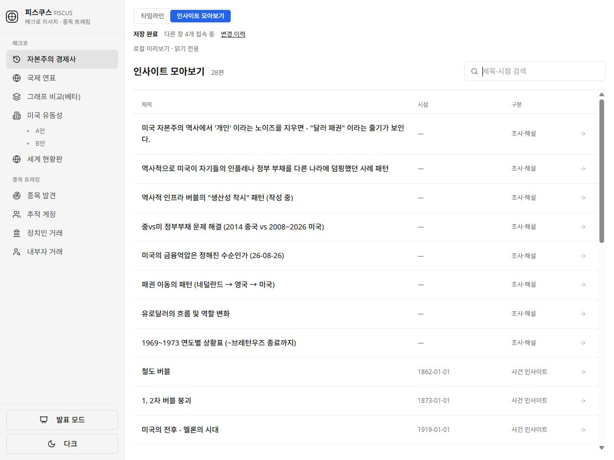
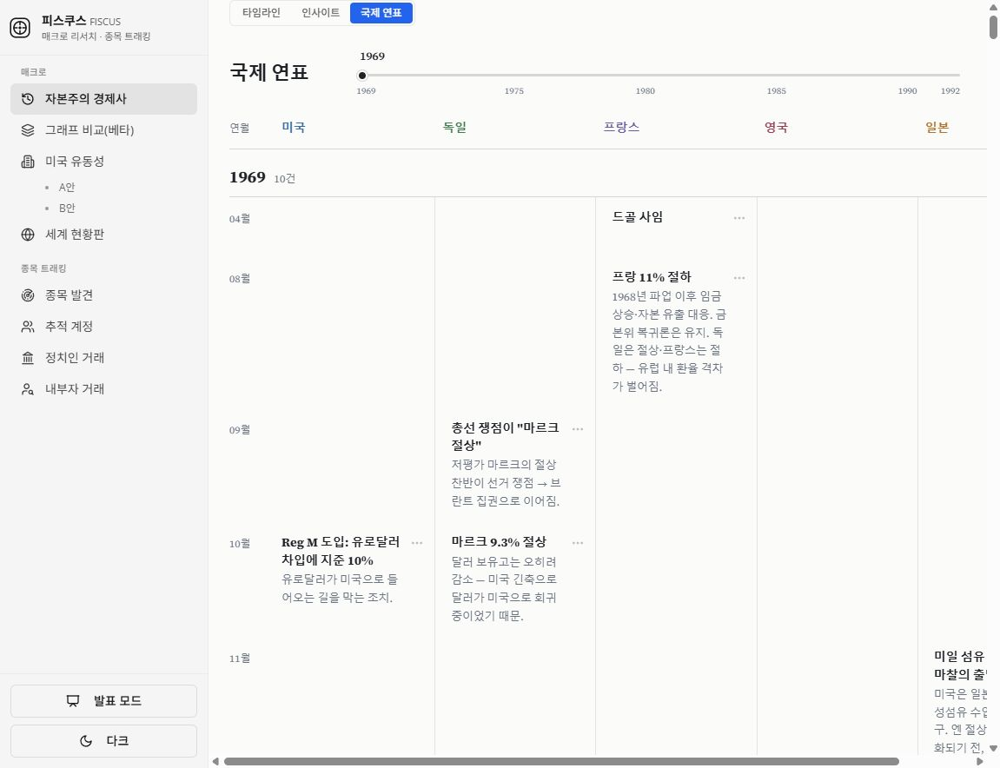
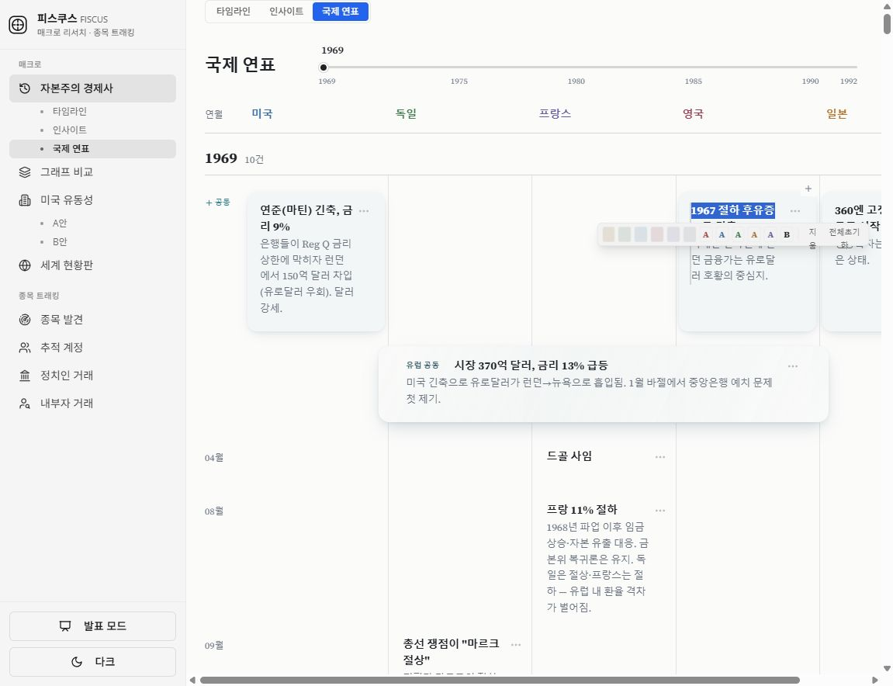
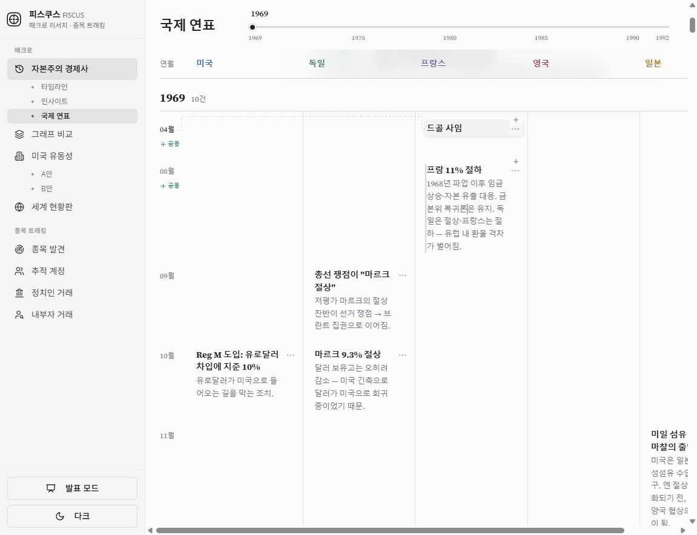
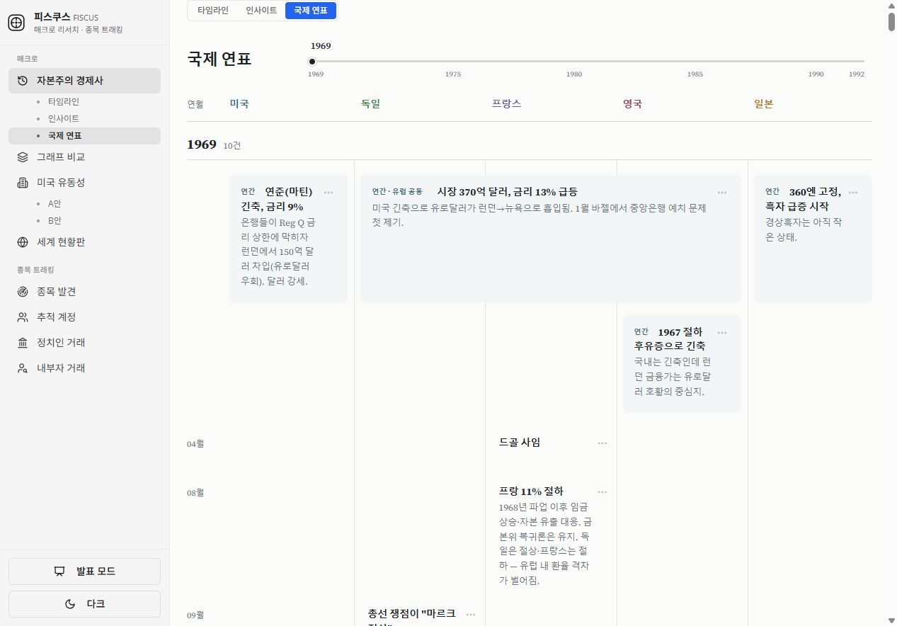

# 인사이트 목록 로컬 검증 — 2026-11-20

- 사용자 요청: 인사이트 모아보기 제목 목록 → 단일 본문 상세. 진입 렌더링 개선. 로컬 확인 후 배포는 나중에.
- 작업 위치: `C:\ticker-radar-master\.deploy\warm-prism-release`, 기준 `28359f9`.
- 미리보기: http://127.0.0.1:5193/#/capitalism → 인사이트 모아보기.
- `npx.cmd vite --config vite.review.config.ts --port 5193`로 실행. GET 전용 운영 프록시, 쓰기 요청 405. 미리보기 환경에서 편집 UI 비활성화.
- 목록/검색/상세만 변경. 원본 콘텐츠, 본문 서식, 협업 저장 프로토콜 유지. 기존 초안 저장기를 재사용.
- 본문 전체 데이터 조회 API는 그대로이며, 이번 개선은 전체 본문을 동시에 그리던 비용을 제거한다. 네트워크 전송량 감소를 주장하지 않는다.

## 확인

- TypeScript 검사 통과.
- 전체 80개 테스트 파일, 627개 테스트 통과. 최종 링크 전달 변경 후 관련 16개 테스트 재통과.
- 프로덕션 빌드 통과(배포 아님).
- 실제 자료 28편 목록: DOM 246개, table/img/iframe/canvas 0개(읽기 전용 안내 추가 전 측정).
- 제목 없는 상황표는 `1969~1973 연도별 상황표 (~브레턴우즈 종료까지)`로 식별.
- 상황표 선택 시 기존 색·굵기와 표가 단일 상세에 표시됨.
- ‘유로달러’ 검색 결과 2편 → 상세 → 목록 복귀 시 검색 유지.
- 마지막 사건 인사이트 상세 → 목록 복귀 시 scrollTop 965 복원 확인.
- 운영 데이터 작성·삭제 테스트는 하지 않음. 저장 경로는 기존 초안 저장 테스트로 회귀 확인했으며, 새 생성/편집 동선의 DB 통합 검증은 배포 전 별도 필요.
- 커밋/푸시/배포 없음. 로컬 브라우저 탭은 사용자 확인용으로 유지.

## 후속 수정 — 편집 복구 / 페이지 이동 / 상단 탭 통합

- 이전 읽기 전용 미리보기 제한은 해제. `tools/local-preview/capitalism.ts`가 처음 한 번 운영 자료를 GET으로 읽고 `.local/insights-preview/snapshot.json`에 사본을 저장한다. 이후 인사이트 변경은 이 파일에만 저장한다. 운영 쓰기 프록시는 계속 차단된다.
- 사본과 실제 운영 데이터는 자동 동기화하지 않는다. 로컬 변경을 운영에 반영하는 작업은 별도이며 이번에는 하지 않았다.
- 새 인사이트·편집·저장·삭제 버튼 복구. 새 검증 카드 작성 → 저장 버튼 없이 다음 글 이동 → 이전 글 → 새로고침 후 제목과 마지막 본문 보존 확인. 해당 검증 카드만 UI에서 삭제하고 28편 복귀 확인.
- 본문 하단 이전·다음 글/현재 번호 추가. 검색 결과 2편에서 첫 글 이전 비활성화, 다음 이동 후 마지막 글 다음 비활성화 확인. 새 글 상단 scrollTop 0 확인.
- 공통 상단 탭 `타임라인 / 인사이트 / 국제 연표`. 인사이트 URL `#/capitalism/insights`, 기존 국제 연표 URL 보존. 국제 연표는 사이드바에서 제거하고 자본주의 경제사 선택 상태로 표시.
- 국제 연표 → 인사이트 왕복 확인. 목록은 제목·시점 두 열, 사건 인사이트 빨간 별.
- TypeScript 검사 및 627개 테스트 통과, 프로덕션 빌드 통과. 배포·푸시 없음.

## 후속 수정 — 국제 연표 헤더와 연도 슬라이더

- 헤더를 국제 연표 제목 + 1969–1992 연도 슬라이더로 정리. 검색·국가 토글·일괄 대사건 펼치기·전체 사건 수·설명 제거. 개별 대사건 펼침과 편집 기능 유지.
- 타임라인 탭 seekToYear처럼 실제 연도 섹션의 위치로 이동한다. 전체 문서 길이 비율을 연도로 환산하지 않는다. 빈 연도는 가까운 연도, 방향키는 다음/이전 존재하는 연도로 이동한다.
- 슬라이더와 국가 헤더 상단 고정. 직접 스크롤 시 현재 연도 동기화. ResizeObserver로 편집·펼침·폭 변경에 따른 연도 높이 재측정.
- 브라우저 확인: Home→1969, ArrowRight→1970, End→1992. 연도 시작 top 129.5–129.8px / 국가 헤더 bottom 130.1px. 1969/1970/1971 높이 각각 1025/851/1444px에서도 정렬. 직접 두 페이지 스크롤 후 1971 자동 표시.
- TypeScript 검사, 관련 테스트 6개 파일 69개, 프로덕션 빌드 통과. 배포하지 않음. 데이터 파일 및 저장 데이터 변경 없음.

## 후속 수정 — 연간 블록과 국제 연표 전용 강조색

- 사이드바 자본주의 경제사 하위에 타임라인·인사이트·국제 연표 추가. 그래프 비교의 베타 표기 제거. 로컬 왕복 이동 확인.
- 월이 특정되지 않은 연간 슬라이스를 연도 첫 위치로 이동. 상반기·하반기와 월별 사건 정렬은 유지. 국가별 연간 내용에 옅은 배경·둥근 모서리·그림자 블록 적용. 왼쪽 연간 텍스트 제거. 공동 사건과 편집/추가/기간 범위 기능 보존.
- 연간 위치 이동에 맞춰 연간 시작 기간 인디케이터의 시작점 포함 보정. 순서·원문 불변과 기간 범위 회귀 테스트 추가.
- 국제 연표 및 해당 편집 팝오버에만 저채도 글자색과 14% 틴트 형광펜 적용. 기존 저장 마크/굵기/본문과 다른 페이지 팔레트는 유지. 읽기 렌더러에 data-mark, 툴바에 data-rich-swatch 속성을 추가해 동일한 범위 CSS를 적용.
- 브라우저에서 1969~1972 연간 슬라이스가 첫 행인지 확인. 기존 빨강/파랑 본문 강조와 편집 툴바 12개 색상 계산값 확인. 본문 입력/서식 적용 작업 없이 선택만으로 팔레트 확인.
- TypeScript, 관련 7개 파일 74개 테스트, 프로덕션 빌드 통과. 배포 없음.

## 후속 수정 — 설명 호버와 월 연결 안내선

- 설명에 포인터를 올리면 해당 국가색 6% 틴트로 영역을 강조. 한 개의 SVG 오버레이가 월 라벨에서 행 상단 여백을 거쳐 설명 왼쪽으로 옅은 점선을 연결한다. 포인터 이탈/창 blur 시 해제한다.
- 연간 블록은 영역만 강조하며 점선은 표시하지 않는다. 글 선택/편집을 가로막지 않도록 오버레이 pointer-events:none. 기존 기간 범위 오버레이는 유지. 크기 변경 재측정 및 reduced-motion 처리.
- 실제 브라우저에서 프랑스 설명 → 08월 연결 경로와 강조 확인, 제목으로 이동 시 active 0/guide false 확인. 영국 연간 설명 active 확인 및 guide false 확인.
- TypeScript 검사, 관련 50개 테스트, 프로덕션 빌드 통과. 로컬만 반영.

## 최종 배포 준비 — 2026-11-20

- 사용자가 평면 디자인 변경 후 배포까지 명시적으로 요청했다. 앞선 로컬 전용 단계 이후의 새 승인이다.
- 첫 연간 행은 미국·유럽 공동·일본, 다음 행은 개별 유럽 국가. 카드 배경/반경/여백 통일, 모든 유리 효과와 그림자 제거. 편집 팝오버·고정 헤더도 불투명 처리.
- 운영 최신 커밋 7703717을 fast-forward로 합쳐 기존 11월 18일 주간 해설을 보존했다. DB나 브라우저 저장 본문을 덮어쓰지 않는다. 로컬 사본과 리뷰 서버 설정은 배포 대상에서 제외한다.
- 최종 검증: 80개 테스트 파일 631개 통과, TypeScript 검사 및 프로덕션 빌드 통과, diff whitespace 검사 통과. 브라우저에서 연간/공동 블록의 shadow:none, backdrop-filter:none 및 불투명 배경 확인.
- 기존 테스트의 글래스 강제 조건은 사용자 최신 평면 디자인 요구에 맞게 갱신했다.

